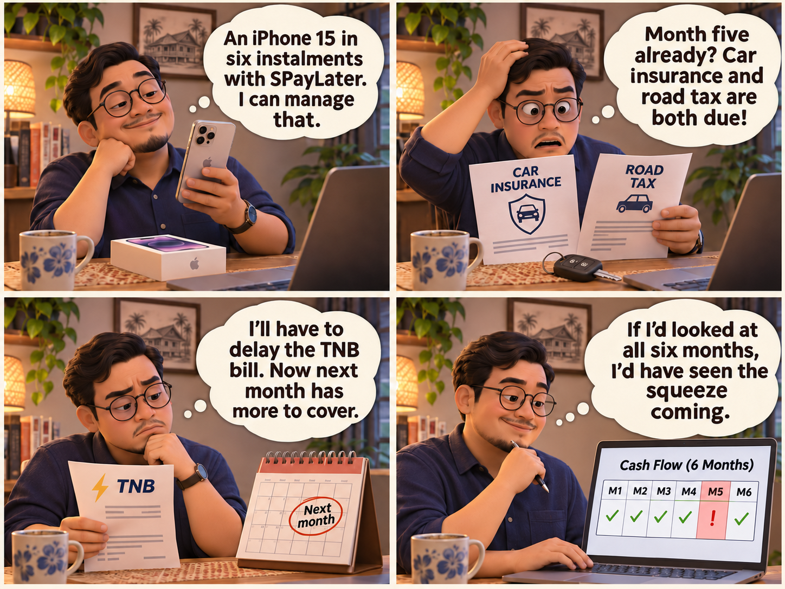
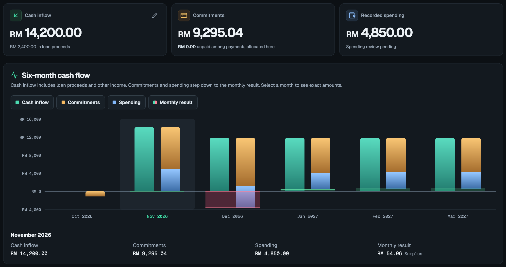
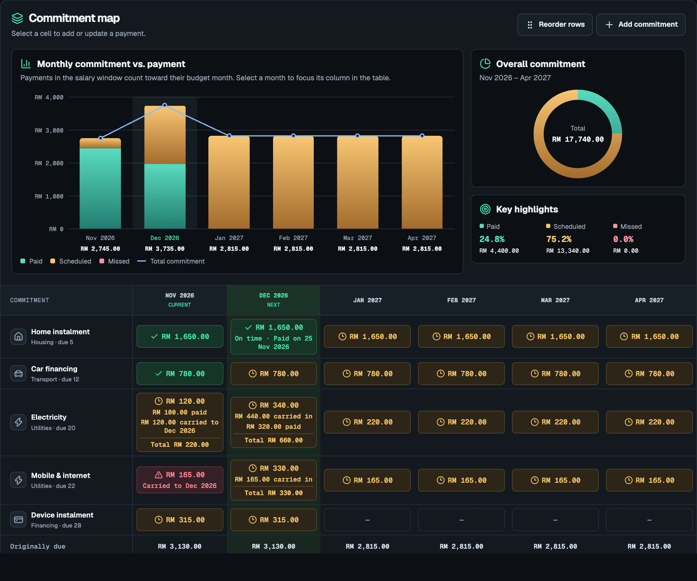
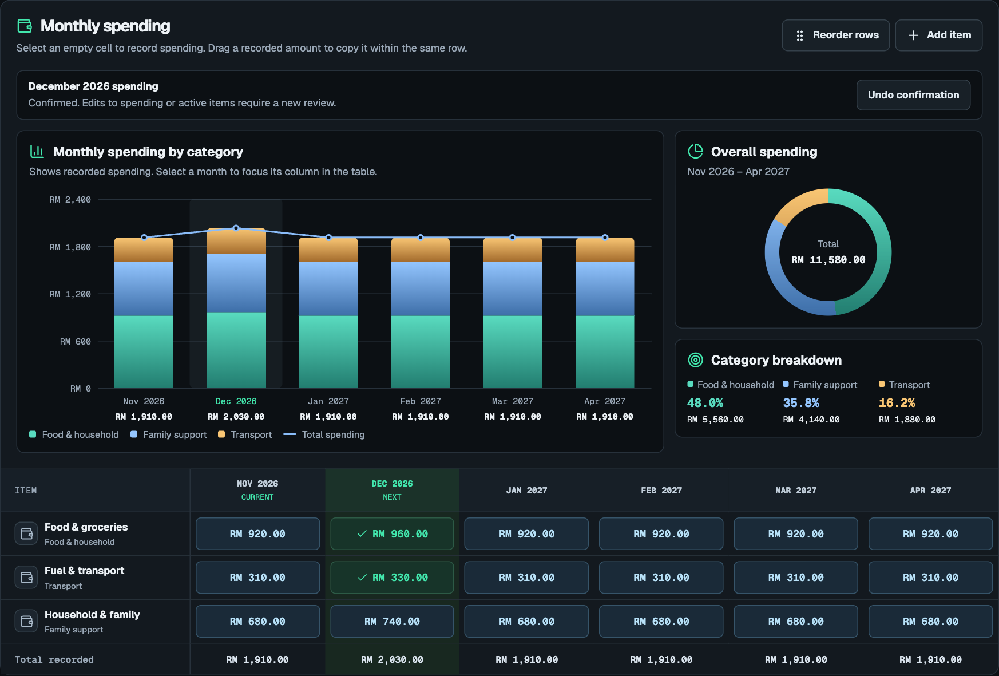
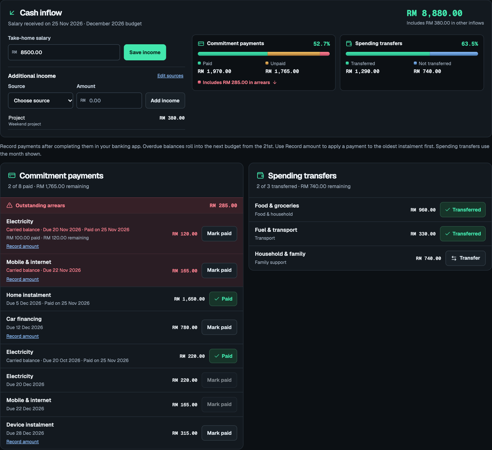
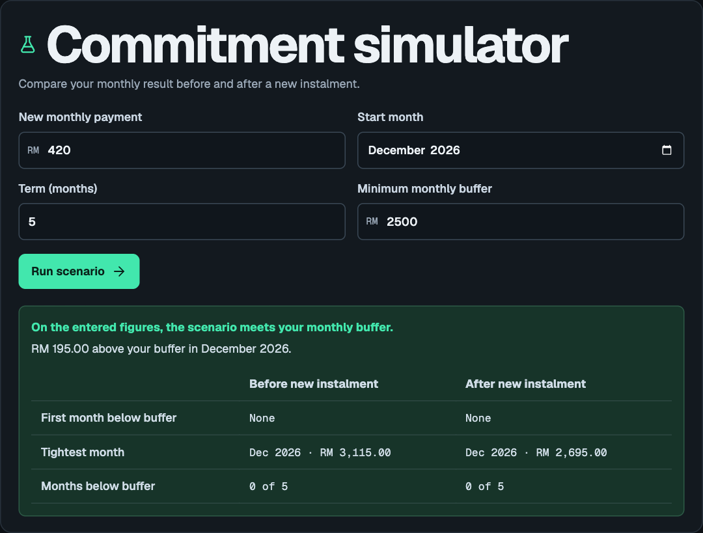
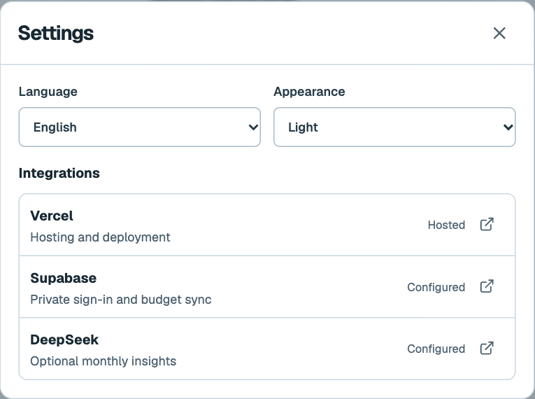

# DFC Budget Map

Plan monthly cash flow in MYR, track payments and spending, and see what a new commitment would do to your budget. Due dates follow Malaysia time.

## When bills collide in month five

[](docs/illustrations/month-five.png)

In this fictional case, a buyer has already committed to six SPayLater instalments for an iPhone 15. In month five, his car insurance and road tax are both due for renewal. He puts off the TNB electricity bill because his budget is short. Month six now has to cover the overdue bill, the final phone instalment and his usual expenses.

Add your annual renewals to the **Commitment Map** in the month they’re due. Before taking on a new instalment, use the **Commitment Simulator** to compare your monthly balances with and without the payment over its full term. If a bill is already being deferred, set its planned payment month and check the impact on both months in **Overview**.

## Start here

| What you want to do | Where to start |
| --- | --- |
| Explore the app | [Try the demo](https://dfc-budget-map.vercel.app/#overview) with a fictional budget. No account needed. |
| Keep a budget in one browser | Open the app and choose **Start fresh**. Save a copy with **Data → Export backup**. |
| Install a local copy with Docker | [Run from GitHub Packages](docs/getting-started.md#run-with-docker) on your computer. |
| Sync a private budget across devices | [Set up your own copy](docs/getting-started.md#deploy-your-own-copy) using GitHub, Vercel and Supabase. |
| Set up the app with an AI agent | [Copy the setup prompt](docs/ai-agent-setup.md#copy-this-first) into ChatGPT Codex, OpenCode, Hermes Agent, DeepSeek Harness or Claude Code. |

### Deploy with Vercel

[](https://vercel.com/new/clone?repository-url=https%3A%2F%2Fgithub.com%2Ffathur6%2Fdfc-budget-map&project-name=dfc-budget-map&repository-name=dfc-budget-map&stores=%5B%7B%22type%22%3A%22integration%22%2C%22integrationSlug%22%3A%22supabase%22%2C%22productSlug%22%3A%22supabase%22%7D%5D)

Vercel guides you through creating your copy and connecting Supabase. Then follow the [Getting Started guide](docs/getting-started.md#2-prepare-your-budget-database) to prepare the database, create your private sign-in, and save your first budget. [Already have a Supabase project?](docs/getting-started.md#connect-an-existing-supabase-project)

## App screenshots

### Cash flow overview

[](docs/screenshots/cash-flow-overview.png)

### Feature highlights

These examples use a fictional budget in the [hosted dashboard](https://dfc-budget-map.vercel.app/). Select a screenshot to view it at full size.

| Commitment Map | Monthly Spending |
| --- | --- |
| [](docs/screenshots/commitment-map.png) | [](docs/screenshots/monthly-spending.png) |
| See what is paid, scheduled or carried forward. | Review the category breakdown and see which amounts have been transferred. |

| Monthly Transfer | Commitment Simulator |
| --- | --- |
| [](docs/screenshots/monthly-transfer.png) | [](docs/screenshots/commitment-simulator.png) |
| Record cash inflow and check off payments and spending transfers. | Compare a proposed instalment against your monthly buffer. |

<details>
<summary>Settings, including language and light mode</summary>

[](docs/screenshots/settings.png)

</details>

## Release version

The sidebar uses the major and minor numbers from `version` in `package.json`. Its patch number is `buildNumber - versionStartBuild`, so Build 22 displays `v3.0.0 (Build 22)` and Build 23 displays `v3.0.1 (Build 23)`. Increment `buildNumber` for each release and keep the package version and lockfile in sync. For a new major or minor series, set `versionStartBuild` to its first build number.

## Run locally

```sh
npm ci
npm run dev
npm test
npm run build
```

The sample budget is fictional. **Start fresh** opens a blank browser budget. **Data** imports or exports a private JSON backup. Browser budgets persist in the current browser and origin. Export before moving between origins or devices. Import replaces the current workspace.

## Install on iPhone

See [Add Budget Map to your phone](docs/getting-started.md#add-budget-map-to-your-phone) for iPhone and Android.

## How projections work

- Open any **Income** cell in Monthly Summary to set the base income for that month and add gifts, project income, loan proceeds or other sources. A blank override uses the default. Set the override to zero for months with only additional sources. Without a known base income, the app leaves the balance blank.
- Gifts, project income and other income are added to the selected month’s income. Loan proceeds appear separately and increase that month’s cash balance. Enter repayments in the Commitment Map.
- The Commitment Map keeps original due dates. Outstanding balances past their due dates appear in the current budget through the 20th, then roll into the next budget from the 21st, in Malaysia time. A payment planned for a later budget stays there until that budget rolls forward. **View transfers** in Monthly Summary shows the original total and each adjustment.
- The dashboard includes paid and unpaid commitments in their allocated months. An instalment with a verified due date becomes missed after its original due day unless marked paid.
- The balance is income plus loan proceeds, minus commitments and recorded spending. Empty spending cells count as zero, including in the simulator.
- The simulator adds the proposed payment to every month of its term and excludes loan proceeds. It includes each instalment in its allocated month and applies older missed payments still due to the first month of the scenario. It checks the lowest remaining balance against the entered buffer.
- Confirm spending from Monthly Summary or Monthly Spending after reviewing a month. The confirmation applies to the saved amounts and active items for that month. The simulator labels scenarios with unconfirmed spending as incomplete and still shows the arithmetic on the entered amounts.
- Open **Monthly Transfer** beside **This month**. From the 21st it opens the next budget month when viewing the current month. Choose **Salary received** to save the take-home income and receipt date for that budget, including paydays before the 21st.
- Use **Record amount** in Monthly Transfer or the payment editor to apply a single payment to the oldest instalment on the checklist first. Payments for the following month's budget count there from the 21st or from an earlier salary receipt, with actual payment dates retained. Spending transfers belong to the selected budget month.
- Use **Set opening cash** in Monthly Summary to project closing cash from a balance at the start of a specified month. Each monthly result carries into the next month. An unknown income month stops the running projection until that income is entered or the opening balance is moved.

## Vercel and Supabase

Follow the [guided deployment](docs/getting-started.md#deploy-your-own-copy) or [connect an existing Supabase project](docs/getting-started.md#connect-an-existing-supabase-project).

The budget migration enables owner-scoped [row-level security](https://supabase.com/docs/guides/database/postgres/row-level-security) and denies anonymous access to the budget table. Cloud saves check a workspace revision to avoid silently overwriting concurrent changes.

## Optional DeepSeek insights

Monthly insights show the result before loan proceeds, commitments moved to later months, and upcoming shortfalls based on the entered figures. Budget Map calculates and displays these facts with or without DeepSeek.

Follow [Enable DeepSeek insights](docs/getting-started.md#enable-deepseek-insights) to create your own API key, save it privately in Vercel and test it with a fictional month. The feature uses DeepSeek's usage-billed Flash API.

## Optional Supabase keep-alive

The **Supabase keep-alive** workflow runs a real read-only Data API query at 04:17, 10:17, 16:17 and 22:17 MYT. GitHub schedules these runs at minute 17 of hours 02, 08, 14 and 20 UTC. It works while the browser is closed. It requests one row from `public.keep_alive_health` and succeeds only if the result is exactly `[{"ready":true}]`. Requests time out after eight seconds. Transient failures allow at most three attempts. A long `Retry-After` causes the run to fail visibly. The workflow does not call a resume API or change quotas.

### Setup

1. In the Supabase SQL Editor, review the hosted project's default table grants and effective budget access before applying the keep-alive migration. Run the following metadata queries as the role that will apply the migration. Review defaults for the migration role and any unexpected entries. Verify that the budget query returns `anon_can_select = false` and `rls_enabled = true`. If there is a mismatch, stop and review it before proceeding. These queries do not read budget rows. See [Supabase's Data API privilege guide](https://supabase.com/docs/guides/api/securing-your-api).

   ```sql
   select defaclrole::regrole as creator,
     case when defaclnamespace = 0 then '(global)'
          else defaclnamespace::regnamespace::text end as scope,
     case when acl.grantee = 0 then 'PUBLIC'
          else acl.grantee::regrole::text end as grantee,
     acl.privilege_type, acl.is_grantable
   from pg_default_acl
   cross join lateral aclexplode(defaclacl) as acl
   where defaclobjtype = 'r'
     and defaclnamespace in (0, 'public'::regnamespace::oid)
   order by 1, 2, 3, 4;

   select has_any_column_privilege('anon', oid, 'SELECT') as anon_can_select,
     relrowsecurity as rls_enabled
   from pg_class
   where oid = 'public.budget_workspaces'::regclass;
   ```

2. Apply [the keep-alive migration](supabase/migrations/20261114000100_keep_alive_health.sql) once, after the budget workspace migration. It removes any default grants on the new table, enables RLS, and grants only `SELECT` to `anon` for the single static row. It checks effective grants inside the same transaction and rolls back if the checks fail. Leave global defaults and budget policies as they are. For a local role test, apply both migrations in a disposable Supabase database, then run `psql -X -v ON_ERROR_STOP=1 -f supabase/tests/keep_alive_permissions.sql` using the local connection from `supabase status`.
3. In the GitHub repository, open **Settings → Secrets and variables → Actions**. Set these two repository values before adding the workflow to the default branch:

   | Kind | Name | Value |
   | --- | --- | --- |
   | Variable | `SUPABASE_URL` | The canonical project URL, `https://<project-ref>.supabase.co`, from the Supabase Connect dialog. |
   | Secret | `SUPABASE_KEEP_ALIVE_KEY` | A publishable key from **Supabase Dashboard → Settings → API Keys**, or the legacy `anon` key if needed. |

   Add the key directly in GitHub. Keep it out of commits and frontend configuration for this workflow. The workflow needs no service-role key, database password, or management token. The app's existing `VITE_*` settings are separate. See [Supabase API keys](https://supabase.com/docs/guides/getting-started/api-keys) and [GitHub Actions secrets](https://docs.github.com/en/actions/how-tos/write-workflows/choose-what-workflows-do/use-secrets).
4. With the workflow on the default branch, open **Actions → Supabase keep-alive → Run workflow**, select the default branch and run it. Open the **check** job and verify that it reports `Supabase health row verified.` This verifies one live read. Review the effective grants on the new table in the hosted database and use a disposable database for write-denial tests.

### Operation and recovery

- For a failed run, open the **check** job under **Actions → Supabase keep-alive**. Configuration, denied access, unexpected data and retry exhaustion fail the job with a short message. In GitHub notification settings, go to **System → Actions**, select email or GitHub notifications, then choose **Only notify for failed workflows**. Scheduled alerts go to the workflow's schedule owner, which can change when someone edits the cron or re-enables it. See [GitHub notification settings](https://docs.github.com/en/subscriptions-and-notifications/how-tos/managing-github-actions-notifications) and [scheduled notification recipients](https://docs.github.com/en/actions/concepts/workflows-and-actions/notifications-for-workflow-runs).
- GitHub can delay or drop scheduled runs. It automatically disables scheduled workflows in a public repo after 60 days without repository activity. Check the run history periodically, even if no failure email arrives. To disable or re-enable the workflow, open its **Actions** page and use the workflow menu. See [GitHub schedule behavior](https://docs.github.com/en/actions/reference/workflows-and-actions/events-that-trigger-workflows#schedule) and [workflow controls](https://docs.github.com/en/actions/how-tos/manage-workflow-runs/disable-and-enable-workflows).
- A normal database query cannot resume a paused project. Open the **Supabase Dashboard**, choose the organization and project, click **Resume project** and confirm. When the project is active, run the workflow manually. See [Supabase Project Pausing](https://supabase.com/docs/guides/platform/free-project-pausing).
- This is best-effort. Supabase may still pause a Free project. **Pro** is Supabase's official option to remove inactivity pausing. Keep separate budget backups using **Data → Export backup**. The health check provides no backup or restore capability.

Visual reference: [Finance Pulse](https://github.com/fathur6/loan-budget-app).

Currency flag artwork from [Flagpedia](https://flagpedia.net/download/api).
